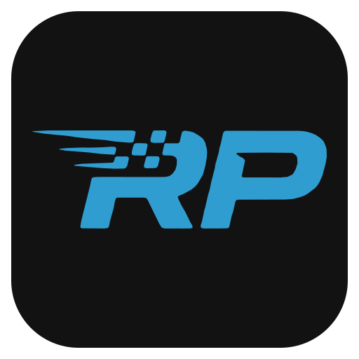

# RacePad

Transforma o celular Android em uma **button box de cockpit** para jogos de simulação no PC
(corrida, caminhão...). Cada botão do celular aperta uma tecla no Windows pela rede Wi‑Fi de casa.

- Botões redondos, interruptores de alavanca e interruptor com capa (ignição), com ícones
- Painel livre: mova, redimensione, adicione e remova controles; desfazer/refazer
- Perfis por jogo (modelos prontos de Corrida e Caminhão), retrato e paisagem em tela cheia
- Teclas F13–F24 por padrão: não conflitam com nenhum atalho e os jogos aceitam no mapeamento
- **Mostradores com dados do jogo** (Le Mans Ultimate): pneus, bandeira, posição, sessão, tempos de
  volta, combustível/energia, carro e gráfico de pedais, no mesmo painel dos botões
- **Overlay no PC**: os mesmos mostradores por cima do jogo, no monitor, sem precisar do celular
- **Análise de voltas**: compara duas voltas gravadas pelo LMU (delta, velocidade, pedais, mapa da pista)
  e exporta em CSV

## Download

Baixe a versão mais recente em **[Releases](../../releases/latest)**:

| Arquivo | Para |
|---|---|
| `RacePad-Setup-x.y.z.exe` | PC com Windows 10 ou 11 (64 bits) |
| `RacePad-x.y.z.apk` | celular ou tablet Android 7.0 ou mais novo (32 ou 64 bits) |

## Instalação

### 1. No PC

1. Rode `RacePad-Setup-x.y.z.exe`.
   O Windows pode mostrar **"O Windows protegeu o computador"** (o instalador não tem assinatura digital
   paga): clique em **Mais informações → Executar assim mesmo**.
2. Deixe marcadas as opções **Liberar no Firewall** e **Iniciar junto com o Windows**.
3. O RacePad Receiver fica como ícone na bandeja, perto do relógio. Clique com o botão direito para ver o
   IP do PC.

A rede Wi‑Fi de casa precisa estar como **Rede privada** no Windows
(Configurações → Rede e Internet → sua rede → Rede privada).

### 2. No celular

1. Baixe o `RacePad-x.y.z.apk` no celular e abra.
2. O Android vai pedir para **permitir instalar apps desta fonte** (navegador ou gerenciador de
   arquivos): permita e confirme a instalação.

### 3. Conectar

1. Celular e PC na **mesma rede Wi‑Fi**.
2. No app: **Config → Procurar na rede → Salvar**.
3. Toque num botão: o status embaixo mostra a tecla enviada.

### 4. No jogo

Nas configurações de controles do jogo, escolha a ação (ex.: "Ligar motor") e toque o botão
correspondente no celular para o jogo gravar a tecla.

## Mostradores (telemetria do Le Mans Ultimate)

Além dos botões, o painel pode mostrar os dados do jogo, atualizados 20 vezes por segundo:

| Mostrador | Mostra |
|---|---|
| **Pneus** | temperatura de cada pneu em 3 faixas (azul frio, verde ideal, vermelho quente), pressão, borracha restante, freio |
| **Bandeira** | bandeira atual, piscando nas amarelas, FCY, azul e vermelha; setores com amarela; o celular vibra |
| **Posição** | posição geral e na classe, distância para o carro da frente e o de trás |
| **Sessão** | tempo restante (ou voltas), temperatura do ar e da pista, chuva |
| **Tempos de volta** | volta atual, última, melhor e delta |
| **Combustível e energia** | combustível, energia virtual, bateria e quantas voltas ainda dá |
| **Carro** | marcha, velocidade, luzes de troca, TC, ABS, distribuição de freio, limitador |
| **Pedais** | gráfico dos últimos 5 s de acelerador, freio e embreagem, e o volante |

Para usar:

1. No Le Mans Ultimate, ligue a **memória compartilhada** nas opções do jogo e reinicie o jogo.
2. No app: **Perfis → Novo perfil → Telemetria (Le Mans Ultimate)** cria um painel pronto com todos os
   mostradores (ou adicione um a um em **Editar → Adicionar**).
3. Com o RacePad Receiver rodando no PC e o jogo aberto, os mostradores se enchem sozinhos.

Sem o jogo, **Config → Dados de demonstração** mostra uma corrida inventada, para montar o painel. No PC,
**Ver telemetria** (botão direito no ícone da bandeja) mostra o que está sendo lido do jogo.

## Overlay na tela do PC

Os mesmos mostradores podem aparecer **por cima do jogo, no monitor**, sem o celular:

1. No Le Mans Ultimate, use o modo de tela **sem bordas** (ou janela). Em tela cheia exclusiva, nada
   aparece por cima do jogo.
2. Clique com o botão direito no ícone da bandeja e escolha **Overlay na tela → Mostrar overlay** (ou
   aperte **Ctrl+Shift+O**).
3. Clique em **Arrumar posições** (ou aperte **Ctrl+Shift+M**) e arraste cada mostrador para onde quiser.
   - Para mudar o tamanho, use o canto de baixo à direita ou a roda do mouse.
   - Para esconder um mostrador, clique nele com o botão direito.
   - Para travar tudo, clique em **Concluir**.

Travado, o overlay não atrapalha: os cliques passam para o jogo, e ele some quando você troca de janela
ou sai da pista. No mesmo menu você escolhe quais mostradores aparecem e a opacidade. Ali também fica
**Dados de demonstração**, para arrumar as posições sem o jogo.

## Análise de voltas

O Le Mans Ultimate pode gravar a telemetria completa de cada sessão. Para isso, ligue **Automatically
Record Telemetry** nas opções do jogo. Para abrir as gravações, clique com o botão direito no ícone da
bandeja e escolha **Análise de voltas**. Ela compara duas voltas pela distância percorrida:

- **delta de tempo** acumulado, velocidade, acelerador, freio, marcha e volante, com uma volta sobre a
  outra (a roda do mouse dá zoom e arrastar move o gráfico);
- **mapa da pista** pintado de verde onde se ganha tempo e de vermelho onde se perde, com a lista dos
  trechos onde mais se perde;
- **Exportar CSV** das voltas, pronto para abrir no Excel.

Ao abrir, ela mostra a gravação mais recente e compara a melhor volta com a segunda melhor. Para comparar
outra volta, dê um clique duplo nela. Para escolher a volta de referência, clique nela com o botão direito.

## Problemas comuns

- **O celular não encontra o PC:** confira se o RacePad Receiver está na bandeja, se a rede do Windows
  está como Privada e se os dois estão no mesmo Wi‑Fi (redes de convidados costumam isolar aparelhos).
  O IP do PC pode mudar: use **Config → Procurar na rede** de novo. Se o Windows perguntou
  **"Permitir acesso?"** e a opção de redes privadas ficou desmarcada, reinstale o RacePad (o instalador
  limpa esse bloqueio).
- **Os mostradores ficam em "sem dados":** o jogo precisa estar aberto com a memória compartilhada ligada
  nas opções (e reiniciado depois de ligar), e **Config → Dados de demonstração** desligado no app.
- **O overlay não aparece no jogo:** o jogo precisa estar em tela **sem bordas** ou em janela, não em
  tela cheia. O overlay só aparece com o LMU em primeiro plano e o carro na pista. Use **Ctrl+Shift+M**
  para ver os mostradores mesmo sem dados.
- **A análise de voltas não mostra nenhuma gravação:** ligue **Automatically Record Telemetry** no LMU
  e dê pelo menos uma volta completa. Se o jogo estiver instalado fora da pasta padrão do Steam, use
  **Escolher pasta** na janela da análise.
- **A tecla chega no PC mas não no jogo:** se o jogo roda como administrador, abra o RacePad Receiver como
  administrador também (botão direito → Executar como administrador).

## Conferir os downloads

Cada release traz `SHA256SUMS.txt`. No PowerShell: `Get-FileHash .\RacePad-Setup-x.y.z.exe`
e compare com o valor do arquivo.

## Desinstalar

- PC: Configurações → Aplicativos → **RacePad** → Desinstalar (remove também a regra do Firewall e o
  início automático).
- Celular: como qualquer app.